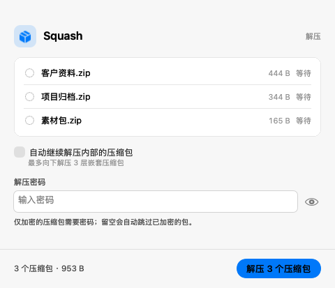
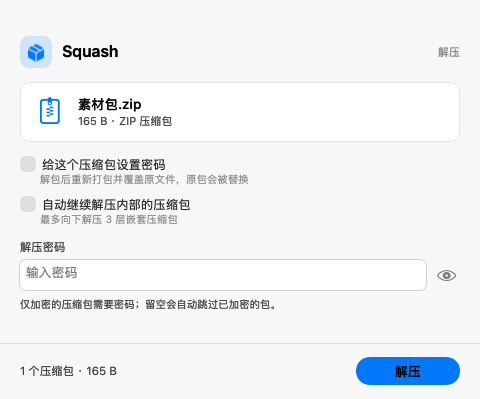
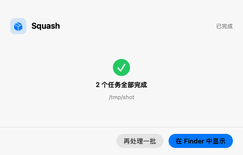

<div align="center">

# Squash

**macOS 上最好用的压缩软件。**

6.5 MB ｜ 双击就开 ｜ 全格式 ｜ 中文名不乱码 ｜ 密码可视化 ｜ 不联网、不登录、不埋点

[](#)
[](#)
[](#)
[](#)
[](#)
[](./LICENSE)

[GitHub](https://github.com/Leeeeeeee-1/Squash) ｜ [Gitee（国内镜像）](https://gitee.com/lees-hub/squash)



</div>

---

## 凭什么说「最好用」

不是堆形容词，是四条能当场验证的硬指标：

| | Squash | 常见方案 |
|---|---|---|
| **中文文件名** | Windows 打的 GBK 压缩包，解出来就是中文，**永久修好** | 一片 `開文件`，改不回来 |
| **设密码** | 输入框 + 强度条 + 明文切换，加密方式自己选 | 藏在对话框里，或者干脆没有 |
| **批量** | 拖 20 个进去，各自解到各自目录，一次搞定 | 一个一个来 |
| **体积 / 启动** | 6.5 MB 原生 AppKit，点开就有 | 上百 MB 的 Electron 壳 |

## 能干什么

**解压**（只写了一条命令，格式由 7-Zip 引擎兜底，实际支持的全部格式都能开）

```
7z  zip  rar  rar5  tar  gz  bz2  xz  zst  lzma  cab  iso  dmg  msi  arj  lzh  cpio  rpm  deb  wim  ...
```

**压缩**：输出标准 ZIP。给别人发文件，Windows 双击能开、Mac 双击能开、手机能开——这才是「通用」。

**其余**

- **可视化加密**：`ZipCrypto`（谁都打得开）/ `AES-256`（需要 7-Zip、WinRAR、Bandizip），二选一，附带密码强度条和「ZIP 藏不住文件名」的提示
- **批量解压**：多选或拖一堆进去，每个包解到自己的同名目录，不会全糊在一起
- **嵌套解压**：包里还有包，自动往下拆，最深 3 层（防止打包机产物炸出几万个文件）
- **给已有 ZIP 加密码**：右键就能加，路径结构原样保留；失败自动回滚，不会把你原来的包弄坏
- **Finder 右键**：「用 Squash 解压」「用 Squash 加密码…」
- **拖到 Dock 图标**：和右键同一条链路
- **深色模式**：跟着系统走，不是反色滤镜

## 三个别人没做对的地方

### 1. GBK 中文名乱码 —— 从字节层修好，不是事后改名

Windows 资源管理器打的 zip，文件名按 GBK 存，**而且不写 UTF-8 标志位**（general purpose bit 11）。macOS 这边所有解压器都会把每个非法字节变成 `U+FFFD`——**原始字节当场就丢了**，你看到的那堆问号和乱码，改名救不回来。

Squash 的做法是在**解压之前**重写包体：解析 EOCD → 中央目录，把名字转成 UTF-8 并补上标志位，**压缩数据原样流式搬运**——不解压、不重压缩、CRC 不变，所以加密包也安全。编码按 `GB18030 → Big5 → Shift-JIS` 依次判定，判不出来就静默回退原包，绝不阻断解压。

### 2. 密码不是附加项，是主流程

大多数工具把「设密码」做成一个需要先勾选的隐藏开关。Squash 把它摆在正中间：输入即看强度，眼睛图标切明文，加密方式选完立刻告诉你「对方需要装什么才能打开」。

### 3. 引擎退出码不再丢

7-Zip 在没给密码的加密包上会转去等 stdin；stdin 是空的，最后只留一句 `Break signaled`。Squash 始终显式传 `-p`，于是能准确区分**「这个包需要密码」**和**「密码输错了」**——这两件事不该都叫「失败」。

<table>
<tr>
<td></td>
<td></td>
</tr>
<tr>
<td align="center">压缩包直接加密码</td>
<td align="center">完成，告诉你落在哪</td>
</tr>
</table>

## 安装

### 方式一：下载 Release

到 [Releases](../../releases) 下载 `Squash.app.zip`，解压后拖进「应用程序」。

**首次打开**：App 是 ad-hoc 签名（没有苹果开发者账号，也就没法公证），Gatekeeper 会拦一下。右键点图标 →「打开」，或执行：

```bash
xattr -dr com.apple.quarantine /Applications/Squash.app
```

### 方式二：自己编译（30 秒）

需要 Xcode Command Line Tools，**不需要装 Xcode.app**：

```bash
# 两边代码一致，按网络情况选一个
git clone https://gitee.com/lees-hub/squash.git                      # 国内
# git clone https://github.com/Leeeeeeee-1/Squash.git               # 海外
cd squash
./build.sh                  # 产物在 build/Squash.app
open build/Squash.app
```

想让 Finder 右键服务生效（服务需要稳定路径）：

```bash
INSTALL=1 ./build.sh        # 装到 /Applications 并注册服务
```

## 无头自测

界面之外的部分全部可测，不弹窗、不需要点鼠标：

```bash
/Applications/Squash.app/Contents/MacOS/Squash --selftest
```

```
[1] 批量解压
    ✓ 两个包各自解到独立目录
[2] 嵌套解压
    ✓ 队列自动扩展为 2 个，深层文件已解出
[3] 重新加密已有 ZIP
    ✓ 已加密（AES-256），路径结构不变，可正常解出
[4] GBK 文件名解压不乱码
    ✓ 名字与内容都正确（已修正文件名编码）

✅ ALL PASS
```

## 开发时怎么截图

UI 调起来最烦的是「必须拿鼠标点」。这里给了几个开关，只在快照模式下生效：

```bash
SQUASH_OPEN=$'/path/a.zip\n/path/b.zip' \
SQUASH_AUTOSTART=1 \
SQUASH_DELAY=0.1 \
SQUASH_DARK=1 \
SQUASH_SNAPSHOT=/tmp/ui.png \
/Applications/Squash.app/Contents/MacOS/Squash
```

`SQUASH_AUTOSTART` 启动即执行，用来截「进行中 / 完成 / 失败」；`SQUASH_DARK` 切外观；`SQUASH_DELAY` 抓瞬时状态。

## 已知边界（诚实清单）

- **Apple Silicon 专用**。内置引擎是官方 7-Zip 26.05 的 `7zz`，官方包只有 arm64。Intel Mac 跑不起来，我没有偷偷帮你跑 Rosetta。
- **macOS 13 Ventura 及以上**。再往下需要新 SDK 兼容性验证，没做。
- **压缩只出 ZIP**。这是刻意的：你要的是「发给谁都能打开」，不是「压得最小」。要 7z 的话用命令行。
- **ZIP 格式藏不住文件名**。即使加密，别人也能看到包里有哪些文件——这是 ZIP 规范决定的，任何说能藏的都在骗你。
- **「加密码」是解包后重打包**。ZIP 不支持原地追加加密，所以会覆盖原文件（有临时目录 + 失败回滚）。文件很大时慢，这是物理限制。
- **没有公证**。所以第一次打开需要右键「打开」一次。

## 技术栈

- **纯 AppKit**，没有 SwiftUI、没有任何第三方依赖。SwiftUI 的 `@State` 在 Swift 6 已变成外部宏插件，只装 Command Line Tools 时 `swiftc` 直接编不过——所以这套界面是手工搭的，顺便换来了更快启动和更小体积。
- **引擎**：官方 [7-Zip](https://www.7-zip.org/) 26.05 macOS 版，打包在 `Contents/Resources/7zz`，不写系统 PATH、不动你的 `$PATH`。
- **约 3000 行 Swift**，一个文件一件事：`Engine`（跑引擎）/ `ZipNameFix`（改编码）/ `BatchRunner`（队列）/ `MainViewController`（界面）/ `SelfTest`（无头测试）。

## 许可

本项目代码 **MIT**，随便用。

内置的 7-Zip 引擎是 **LGPL-2.1+ 且带 unRAR 限制**，版权归 Igor Pavlov。详见 [docs/NOTICE.md](docs/NOTICE.md)。

---

<div align="center">

## Squash

**The best archiver for macOS.** — *6.5 MB, native AppKit, zero dependencies.*

Opens every format 7-Zip knows. Fixes GBK filenames from Windows archives
*at the byte level* (rewrites the central directory, never re-compresses).
Visual password setup with strength meter. Batch + nested extraction.

Apple Silicon · macOS 13+ · MIT · no network, no telemetry, no account.

</div>
